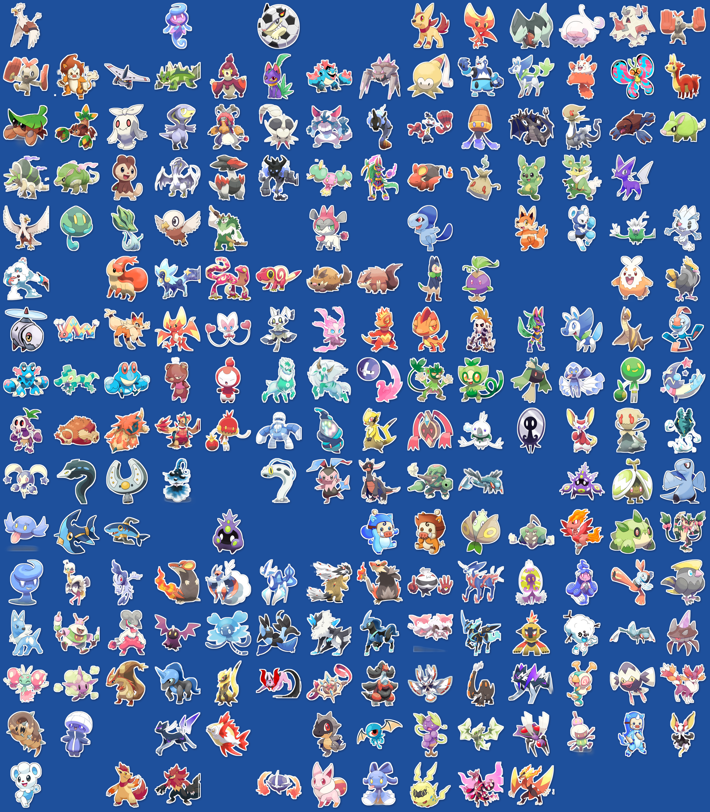

# PentaPets — EtherFantasy Pet Stickers

The official PentaPets sticker art: **221 EtherFantasy / Ethermon pets**, each a
die-cut style PNG with a white border on a transparent background.

## Collect them
Collect numbered editions, swap with friends and use them in any chat in the
**PentaPets Sticker Store**: [t.me/PentaPetsBot/stickers](https://t.me/PentaPetsBot/stickers).

## Use
- **Everyone** may use the official PentaPets sticker packs in Telegram and share
  unmodified screenshots and posts that show them.
- **Holders** of a numbered edition may display it anywhere and print that exact
  sticker on physical items, including selling small runs (up to 500 per edition per
  year).
- **No derivatives, no NFT minting elsewhere, no AI training.** The characters and art
  remain owned by Mons Studio / EtherFantasy.

## License
**All rights reserved**, under the PentaPets Sticker License v1.0. See [`LICENSE`](LICENSE).
Files obtained before 5 October 2026 were released under CC BY 4.0; see section 4.
